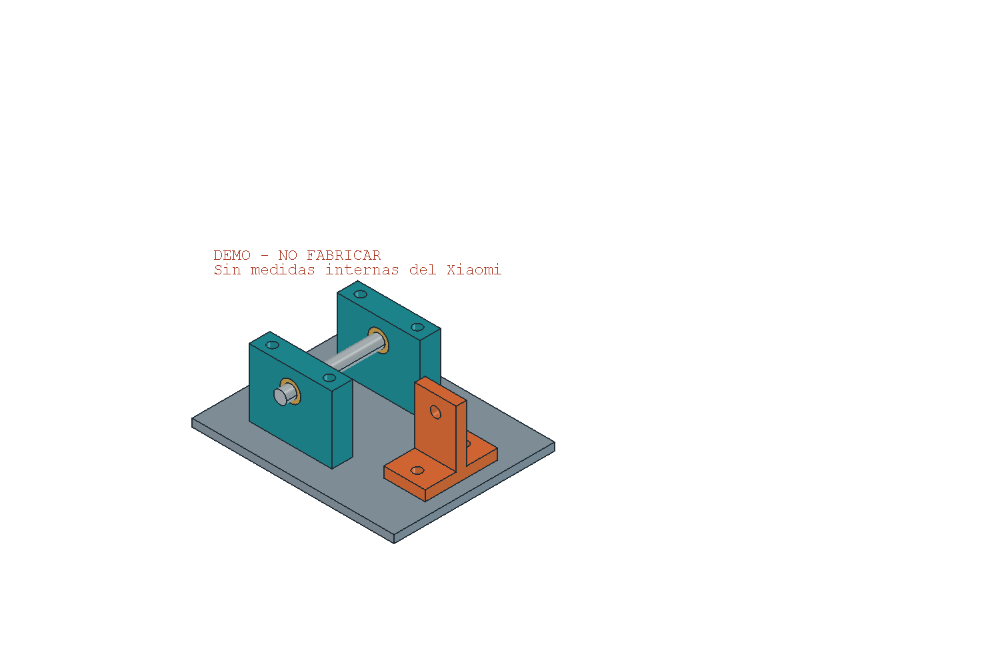

# 14 — CAD inicial ejecutado y siguiente levantamiento

**25-10-2026 · Entrega v0.1.** El trabajo pasa de investigación a un proyecto FreeCAD editable, con una decisión de estructura y un registro de interfaces. No se ha terminado una base fabricable.

## 1. Resultado de los tres frentes

Los informes completos están en [11 — Estructura](11-base-resistente-y-reconstruccion.md), [12 — Mecanismos y estación](12-interfaces-mecanicas-y-estacion.md) y [13 — Electrónica y apertura del control](13-electronica-y-control-abierto.md). La revisión del CAD está en [cad/REVISION.md](cad/REVISION.md).

La arquitectura elegida para desarrollar es **un núcleo resistente propio y soportes funcionales reemplazables**. Se evaluará una solución híbrida de caminos de carga metálicos y piezas pequeñas fabricables por impresión o procesos sencillos. El material, el espesor y los recortes se deciden después de colocar los conjuntos y definir cargas/proceso; aumentar indiscriminadamente metal o relleno no es una prueba de robustez.

| Elemento | Decisión | Comprobación que sigue pendiente |
|---|---|---|
| Núcleo de base | Mantiene relaciones geométricas críticas; no depende de orejetas originales | Implantación, uniones, rigidez con recortes, masa y reparto de apoyos |
| Suspensión | Cartucho por lado con apoyos y anclajes sustituibles | Geometría propia de ambos lados, parte móvil dañada, giro, retención y respuesta del muelle |
| Electrónica | Bandeja aislante separada de la función estructural | Fijaciones, altura de montaje, conectores, radio, disipación y servicio |
| Batería | Cuna independiente para pack cerrado | Envolvente, retención, cableado y extracción |
| Limpieza y aire | Conservar conjuntos íntegros y hacer cunas/ductos/juntas sustituibles | Alturas, movimientos, flujo, sellos y acceso |
| LDS y frontal | Soportes propios que mantengan referencias y movimiento | Altura/orientación óptica, flex y recorrido de paragolpes |
| Estación | Condición funcional desde el principio | Rampas, contactos, IR, boca/sello y bandeja en cada postura real |

Se conservan dos incógnitas concretas: el daño en la **mitad móvil** de la rueda y la función de la pieza negra tubular observada en la carcasa superior de F018. No se considera la superior íntegramente decorativa ni se asigna a esa pieza una función por su forma.

## 2. Lo que realmente existe en CAD

Maestro: **[cad/X20Pro_Base_Arquitectura.FCStd](cad/X20Pro_Base_Arquitectura.FCStd)**. Tiene dos hojas nativas, siete grupos de trabajo, 13 registros de módulos observados y 14 interfaces. La envolvente exterior usa únicamente Ø350 × 97 mm publicados por [Xiaomi](https://www.mi.com/es/product/xiaomi-robot-vacuum-x20-pro/specs/).

El estudio del cartucho tiene siete sólidos paramétricos y un rótulo de no fabricación. Está fuera de la envolvente y sus números son de demostración. La base real permanece pendiente: no se han colocado agujeros ni módulos imaginando cotas desde fotografías.



La documentación de apertura, árbol, edición y reproducción está en [cad/README.md](cad/README.md). El registro de interfaces es consultable también sin FreeCAD en [cad/interfaces.json](cad/interfaces.json). El STEP permite revisar el estudio en otros programas, pero conserva la misma limitación conceptual.

## 3. Ejecución y verificación

FreeCAD **1.1.4**, paquete de usuario `org.freecad.FreeCAD` desde Flathub, se instaló y ejecutó en Bazzite. No se necesitó cambiar de sistema, comprar impresora ni sustituir la electrónica.

Se comprobó que el FCStd se guarda y reabre manteniendo sólidos, inventario y parámetros; al cambiar el hueco DEMO de 26 a 30 mm, el apoyo B se desplaza 4 mm y la placa/pasador cambian coherentemente. Después se volvió a 26 mm. Se reimportó el STEP para contrastar siete sólidos. Estas operaciones validan la cadena CAD y su editabilidad, no una construcción física.

La inspección visual encontró una colocación incorrecta del estudio: FreeCAD devuelve la ruta de expresión con un punto inicial (`.Placement.Base.x`). Se corrigió el generador y el documento, y se comprobó que el conjunto empieza en X=250 mm, más allá del límite X=175 mm de la referencia. La captura inicial sin contexto OpenGL se sustituyó por una captura real del escritorio. Estos fallos se resolvieron antes de la entrega.

Resultados y hashes: [cad/validacion_cad.json](cad/validacion_cad.json). No se han registrado ensayos físicos ni órdenes al robot como realizados. Los 73 registros Mxx siguen sin valores de medida; incluyen grupos de datos, no 73 dimensiones obligatorias antes de dibujar.

## 4. Cómo avanzar sin los fragmentos

Se reconstruyen **interfaces útiles**. Un agujero intacto de módulo, su eje, un plano de asiento, un depósito o el otro lado de un encaje pueden definir un soporte nuevo sin reproducir el tetón que se rompió.

La posición local de una pieza y su posición dentro del robot son problemas distintos. Si se ha perdido la relación global, se marca como perdida y se intenta recuperar mediante contrapartes todavía unidas, un útil reproducible, medidas de otro D102GL o una posición nueva deliberada que requiera pruebas. La simetría y la foto comercial no la convierten en una cota OEM.

### Paquete inicial de captura

No hace falta repetir las 18 fotos ni abrir conjuntos sanos. Para el primer cartucho, recoger lo siguiente con el robot sin energía y sin forzar piezas deterioradas:

1. **Orientación común:** vista cenital de lo que queda de la base, frontal marcado, regla en el plano y referencias intactas señaladas. Identificar qué relaciones todavía son rígidas; sirve para M40, no para extraer todas las alturas de una foto.
2. **Una rueda completa, lado identificado:** ambas caras y perfil, detalle de su eje/pivote, pasador, zona móvil rota y enganche del muelle. Medidas directas de diámetro/longitud del pasador, ancho del alojamiento, separación de contracaras y relación pivote–eje de rueda. Evitar comprimir varias coordenadas en una única cifra. M41 y M04–M09.
3. **Extracción:** dirección por la que puede salir ese conjunto, pasador y conector, y qué piezas estorban. Una vista con una regla no sustituye probar la maniobra en un útil seguro. M43.
4. **La otra rueda como conjunto distinto:** su geometría se captura por separado cuando esté disponible; no se genera por espejo de la primera. M42.
5. **Estación y limpieza antes de cerrar el perímetro:** perfil de rampa/extensor, contactos y boca del robot, depósito, caja de cepillo y caras de fijación de mopas. Se incorporan como modelos simplificados medidos; no hace falta modelar cada engranaje. M46, M49–M50, M52 y M54–M55.

Las medidas de fuerza y recorrido del muelle, M44, cierran la decisión de suspensión antes de uso. Un resorte más largo modifica longitudes y brazos de palanca; que quepa no demuestra equivalencia. La altura de mopas y su relación con la bandeja se resuelven antes de congelar el fondo.

## 5. Robot abierto por fases

El objetivo final incluye control abierto. Conservar placa y firmware Xiaomi al principio permite comprobar la mecánica manteniendo una referencia de funcionamiento, pero esa primera etapa no es un robot de software completamente abierto.

- **A — Mecánica abierta:** CAD editable, piezas identificadas, interfaces, acceso y montaje, con control original provisional.
- **B — Supervisión:** evaluar las órdenes y datos realmente disponibles. `hass-xiaomi-miot` tiene una configuración específica D102GL; eso no aporta drivers abiertos de motores o navegación.
- **C — Control principal abierto:** software sobre la placa existente solo si se demuestra viable, o una controladora sustituible que reutilice módulos con interfaces caracterizadas. No se promete conservar toda placa a cualquier coste.
- **D — Dependencias restantes:** inventariar firmware de módulos, carga y estación todavía cerrado y decidir qué abrir o sustituir según utilidad y presupuesto.

[Valetudo](https://valetudo.cloud/pages/general/supported-robots/) no incluye X20 Pro en su lista declarada exhaustiva y explica que no es firmware propio. No hay una ruta de instalación soportada que podamos presentar como solución del Pro. El [capítulo 13](13-electronica-y-control-abierto.md) documenta esta búsqueda y las alternativas con sus límites.

## 6. Checkout, archivos y revisión colaborativa

Checkout del PC:

```text
/var/home/Valdi/Documentos/X20ProAbierto/Valdo
```

Ruta del maestro dentro del checkout:

```text
research/2026-10-25-xiaomi-x20-pro/cad/X20Pro_Base_Arquitectura.FCStd
```

Repositorio remoto: [Valdi320/Valdo, investigación X20 Pro](https://github.com/Valdi320/Valdo/tree/master/research/2026-10-25-xiaomi-x20-pro). La copia de trabajo de investigación del asistente está en `/workspace/scratch/7120d32cf0b1/Investigacion_Xiaomi_X20_Pro_20261025`; no es un checkout Git. El directorio antiguo de Documentos se conserva como copia de trabajo, pero el checkout es el punto de continuación compartido.

Ámbito de esta entrega: README, plan 07, registro 08, inventario 10, nuevos capítulos 11–14, `mediciones.csv`, carpeta `cad/` y dossier HTML consolidado. Las notas transitorias `x20_base_work/` se han integrado en los capítulos y la revisión de CAD; no son otra fuente maestra.

**Apoyo más útil para la revisión independiente:** revisar `interfaces.json`, capítulos 11–13 y `cad/REVISION.md`, y entregar una matriz que relacione cada interfaz con su referencia recuperable, camino de carga, pieza reemplazable, ruta de extracción y condición de aceptación. El siguiente entregable físico al que sirve es **el primer cartucho adaptado a la rueda real con su referencia de montaje**, no otra representación completa del robot sin medidas.

El revisor puede trabajar en una nota nueva sin editar el FCStd ni los ficheros que coordina el autor. Las comprobaciones locales de CAD aquí registradas pertenecen a un proyecto nuevo y aislado; no se han ejecutado suites de otros proyectos ni modificado su cerrojo. Esta coordinación no cambia las reglas de publicación del otro chat.

---
Documentación original: CERN-OHL-P-2.0, según [cad/LICENCIAS.md](cad/LICENCIAS.md). La licencia cubre esta aportación propia, no firmware o diseños Xiaomi.
