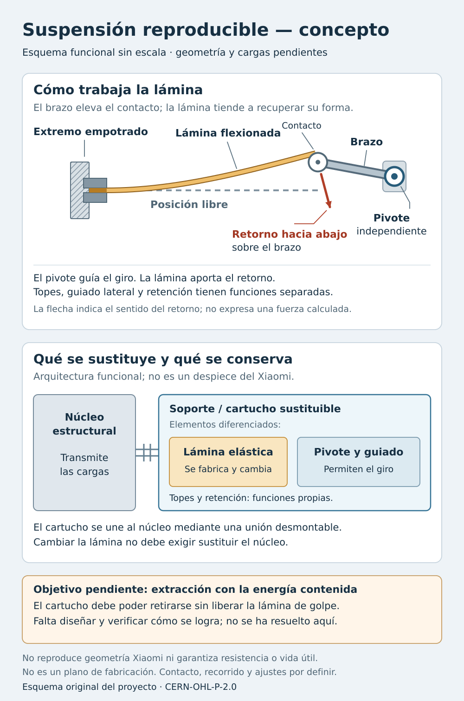

# 16 — Suspensión reproducible: fabricar también la función del muelle

**25 de octubre de 2026 · Requisito del propietario incorporado.** El elemento elástico debe poder fabricarse y comprobarse a partir de materiales especificados, sin depender de un recambio exclusivo del Xiaomi. Esta entrega selecciona una primera arquitectura para estudiar y documenta las alternativas. Todavía no contiene una suspensión dimensionada, fabricada o validada.

## 1. Qué cambia en el proyecto

El objetivo deja de ser adaptar el soporte al muelle de repuesto disponible. Ahora se diseña **la función de suspensión completa**, incluida la pieza que almacena energía y devuelve la rueda hacia su posición de apoyo. No es necesario conservar la forma helicoidal del resorte original.

La apertura del hardware exige fuentes editables y permisos para estudiar, modificar, fabricar y distribuir; OSHWA también recomienda materiales accesibles y procesos habituales [S1]. El propietario añade un requisito de autonomía práctica: poder reproducir el elemento elástico y verificarlo. Comprar fleje, alambre o filamento seguirá siendo necesario; la dependencia que buscamos eliminar es la de una pieza exclusiva sin receta de fabricación ni alternativa documentada.

**Criterio de éxito propuesto:** otra persona puede fabricar un recambio siguiendo nuestros archivos, especificación de material, proceso y comprobación funcional, sin encontrar un muelle OEM. La sustitución de ese recambio debe conservar el núcleo del robot y permitir mantenimiento localizado. La electrónica y el firmware reutilizados siguen siendo dependencias separadas; abrir esta suspensión no los convierte en abiertos.

El resorte original sano, si existe, puede aportar una referencia experimental. El más grande considerado anteriormente queda como opción de comparación o prototipo, sin gobernar la arquitectura ni bloquear el trabajo. Tampoco hace falta recuperar los fragmentos rotos.

## 2. Primera arquitectura para estudiar: cartucho con ballesta metálica

Una **ballesta de una lámina** es una tira de material elástico que se flexiona y ejerce una fuerza de retorno. Los muelles planos permiten almacenar energía y relacionar fuerza con desplazamiento; elegir material, geometría y fabricación forma parte de su diseño [S2]. Para este robot proponemos estudiar una lámina inicialmente plana y de contorno sencillo, sujeta mediante una mordaza desmontable.

La figura es propia, funcional y sin escala. No reproduce un módulo Xiaomi ni prescribe dónde fijar o perforar la carcasa superviviente. La colocación, el contacto con el brazo y el espacio disponible están pendientes.

| Función | Pieza o solución propuesta | Qué deberá comprobarse |
|---|---|---|
| Conservar referencias del robot | Núcleo resistente y asientos de cartucho | Posición bajo carga y después de desmontar/reinstalar. |
| Guiar y retener la rueda | Pivote con apoyos y retención propios | Giro libre, juego, apriete, cargas y retención incluso si falla la pieza elástica. |
| Proporcionar retorno | Lámina reemplazable de material para muelles | Curva de fuerza, recorrido admisible, deformación residual y evolución con el uso. |
| Transmitir la fuerza al brazo | Contacto o unión desmontable por diseñar | Barrido, rozamiento, desgaste, carga local y ausencia de pérdida de contacto en el recorrido útil. |
| Limitar posiciones extremas | Topes propios del cartucho | Intervenir antes de sobrecargar lámina, detector, cable o transmisión. |
| Informar a la electrónica | Detector original que realmente se identifique | Conservar su actuación; su placa o actuador no sirven como tope estructural. |
| Facilitar servicio | Cartucho extraíble y procedimiento de contención | Acceso a fijaciones/conector; mantener contenida la energía elástica al extraer y descargar el conjunto. |

La ventaja prevista es poder cambiar la lámina, su mordaza o un apoyo sin rehacer el núcleo. No se diseña una pieza destinada a romperse: la separación permite mantenerla si se desgasta o falla. Esta ventaja de mantenimiento no demuestra todavía una vida útil superior a la original.

**La lámina no sustituye por sí sola el pivote ni repara una reductora rota.** Si el brazo o el alojamiento que posiciona engranajes está dañado, esa interfaz requiere una solución propia. La carga de la suspensión debe llegar a superficies capaces de transmitirla, no trasladarse a otro saliente frágil del mismo módulo.

### Por qué es la primera candidata

Nuestra hipótesis es que un contorno plano, una sujeción accesible y una longitud activa definida pueden resultar más reproducibles con medios modestos que bobinar un resorte pequeño con ganchos y tensión inicial controlados. Habrá que comprobar disponibilidad de material en pequeñas cantidades, proceso de corte/acabado, espacio útil y coste real. Aún no se ha elegido acero, espesor ni proveedor.

Se buscará material suministrado en un estado útil para la aplicación, con trazabilidad suficiente para evitar que el usuario necesite improvisar tratamientos térmicos. Esto es una preferencia de fabricación, no la afirmación de que cualquier fleje listo para cortar sea adecuado.

Las fichas de Alleima muestran que grado, espesor y condición de suministro importan para resistencia, fatiga y relajación [S3]. Su ficha Chromflex advierte además de posibles cambios en el borde por el calor del corte láser [S4]. Por tanto, «acero inoxidable», «chapa parecida» o una tira recuperada sin identificar no constituyen nuestra especificación final; un acabado visualmente liso tampoco demuestra que se haya eliminado un efecto térmico.

## 3. Alternativas comparadas

| Ruta | Qué fabricaríamos | Ventaja prevista | Incertidumbre decisiva | Prioridad |
|---|---|---|---|---|
| **Lámina metálica en cartucho propio** | Contorno de la lámina, mordaza, apoyos y útil de verificación | Pieza simple y separada; posibilidad de reproducirla a partir de fleje especificado | Fatiga en bordes/sujeción, material accesible, espacio y contacto con el brazo | Primera para desarrollar. |
| **Muelle de alambre fabricado con un útil abierto** | Bobinador, espiras y extremos de un resorte definido | Arquitectura compacta y materia prima identificable | Recuperación elástica tras bobinar, ganchos, tensión inicial, repetibilidad y proceso posterior requerido | Segunda vía si la lámina no cabe o su fabricación resulta peor. |
| **Flexura o cartucho elástico impreso** | Elemento de PP, PA, TPU u otro material tras selección | Reproducir geometría con la impresora y sustituir una pieza pequeña | Fuerza sostenida, fluencia/relajación, variación de impresión, fatiga y condiciones ambientales | Investigación experimental paralela; sin aprobación para uso. |
| **Resorte continuo genérico, cortado y terminado según su fabricante** | Longitud y extremos a partir de un producto estándar | Alternativa de prototipo sin referencia Xiaomi | Sigue comprándose el elemento ya bobinado; falta comprobar curva y límites | Recurso intermedio, no cumple por sí solo fabricar el resorte desde materia prima. |

Lee Spring comercializa expresamente resortes continuos para que el usuario corte y forme los extremos, y explica que la respuesta depende de espiras activas y tensión inicial [S5]. Es evidencia de una alternativa genérica, no de compatibilidad con este robot ni de disponibilidad local.

### Por qué no basta con imprimir algo que rebote

Una pieza puede recuperar su forma al doblarla una vez y cambiar después bajo carga permanente. Conviene distinguir **fluencia** —deformación que evoluciona manteniendo carga— y **relajación** —fuerza que disminuye manteniendo deformación—. La suspensión puede permanecer precargada mientras el robot está estacionado; necesitamos conservar su comportamiento en ese estado y durante movimiento.

Un estudio primario sobre PETG fabricado por FFF midió fluencia y dependencia de la orientación de fabricación [S6]. Otro sobre TPU Filaflex 70A impreso midió relajación sin alcanzar claramente equilibrio durante el ensayo [S7]. Esas pruebas justifican estudiar la deriva temporal; no permiten asignar a nuestra futura pieza un porcentaje de pérdida de fuerza ni una duración.

PP y PA quedan como materiales a investigar, sin una clasificación universal. Una bisagra flexible o un mecanismo de posicionamiento impreso no acredita por sí solo una suspensión sometida a precarga, impactos y muchos ciclos. Para cualquier candidato se necesita un material y proceso concretos, geometría propia y comprobación funcional.

## 4. Qué debemos reproducir: fuerza en la rueda a lo largo del recorrido

La especificación funcional es la relación entre **posición de la rueda y fuerza de retorno**, junto con fricción, límites, detección, retención y estabilidad temporal. Dos resortes de igual longitud pueden producir respuestas distintas. También una misma lámina puede producir otra respuesta al cambiar su apoyo, longitud activa o punto de contacto. Los materiales docentes de IIT Delhi explican la relación geométrica entre desplazamientos y fuerzas de rueda y elemento elástico [S8].

En un mecanismo ideal de un grado de libertad, sin rozamiento y en equilibrio cuasiestático, el trabajo virtual relaciona las magnitudes de fuerza mediante `F_rueda = F_elástico · |dx/dy|`, siendo `x` la deformación del elemento e `y` el desplazamiento correspondiente de rueda, y las fuerzas las asociadas a esos desplazamientos. La geometría real, los cambios de contacto y la fricción exigen una evaluación más completa. Esta expresión orienta el diseño; no contiene parámetros conocidos del X20.

Como aproximación inicial de una lámina rectangular en voladizo, delgada, lineal y con pequeña deflexión bajo carga transversal en el extremo, `k = E·b·t³/(4·L³)` [S9]. Aquí `E` es el módulo elástico, `b` la anchura, `t` el espesor y `L` la longitud activa. Engrosarla modifica mucho la rigidez. Para desplazamiento impuesto también cambia la tensión de flexión: aumentar espesor no es una mejora automática. Este modelo no representa todavía nuestro brazo, contacto, grandes desplazamientos ni una impresión anisótropa.

El ajuste de longitud activa puede servir para explorar variantes, pero altera simultáneamente rigidez y solicitación. No se tratará como un mando inocuo de precarga. Cualquier ajuste operativo deberá quedar fijado y documentado, con límites definidos.

| Dato o relación | Evidencia disponible y siguiente uso |
|---|---|
| Pivote, anchura móvil y recorrido | Existen cotas públicas parciales y el estudio axial; faltan geometría completa y comprobación física. La consulta de Codex al proveedor sigue siendo útil para estas interfaces. |
| Fuerza objetivo y precarga | Pendientes. Buscar datos públicos y usar una referencia sana si es accesible; si no existe, definir objetivos funcionales del conjunto y validarlos. |
| Masa y reparto de apoyos | Pendientes para el bastidor nuevo. Dividir el peso total por dos no reproduce automáticamente la carga de cada rueda: intervienen otros apoyos y estados. |
| Espacio para lámina y extracción | Comparar envolventes y barridos en CAD, con parámetros de procedencia explícita. Una vista sin escala no proporciona estos valores. |
| Material y fabricación repetible | Seleccionar grado/estado, sección, bordes, método y tolerancias; después evaluar ejemplares reales. |
| Detector, cableado y estación | Mantener las interfaces identificadas en 12 y la revisión IF01–IF04/IF13. No se presupone el tipo de detector ni una configuración nueva admitida por el firmware. |

Estos pendientes limitan la aprobación física, pero permiten estudiar arquitectura y variantes provisionales. No se convierte una nueva solicitud de medidas al propietario en requisito para continuar la investigación.

## 5. Qué publicaremos para poder fabricar el recambio

1. **Definición funcional.** Recorrido, curva de fuerza y estados de servicio, con origen y límites de los datos.
2. **Fuentes editables.** CAD nativo FreeCAD, planos y parámetros del cartucho, elemento elástico y útiles; exportaciones para fabricar cuando procedan.
3. **Material por especificación.** Grado, condición, sección y propiedades relevantes. Un enlace de compra ayuda al primer prototipo, pero no sustituye esta descripción.
4. **Proceso.** Corte o conformado, sujeción, acabado, orientación de material/impresión cuando importe, montaje y control. Si necesita taller o tratamiento especializado, declararlo y compararlo con una alternativa accesible.
5. **Útil de comprobación.** Definición de posición, aplicación de carga, medición y repetición. Un útil impreso puede servir para fabricar o comprobar una pieza metálica.
6. **Resultados y límites.** Revisión probada, ejemplares, condiciones, curvas, fallos, cambios tras carga sostenida y ciclos; criterios de aceptación definidos antes de declarar que funciona.
7. **Mantenimiento.** Acceso y contención de energía, extracción, cambio del componente, reinstalación y recuperación de posición sin desmontar conjuntos ajenos cuando la implantación lo permita.

Una segunda fabricación siguiendo la documentación, idealmente por otra persona, será una comprobación fuerte de reproducibilidad. La primera sirve para demostrar viabilidad y corregir la receta.

## 6. Recursos abiertos aprovechables

**Venom Lab — spring-winder.freecad** publica un bobinador manual parametrizable con `SpringWinder.FCStd` y licencia MIT [S10]. Se verificaron directamente README y LICENSE. El autor declara FreeCAD 0.21.x y Assembly 4; la variante sin rosca está implementada. No se ha abierto ni recalculado en nuestro FreeCAD 1.1.4, ni se adopta como receta validada de suspensión. Es un recurso para la segunda vía, no una razón para elegir alambre antes de estudiar el espacio y la fuerza.

La investigación también localizó útiles de tracción y torsión y proyectos de flexuras. Se conserva como regla comprobar por archivo fuente, licencia y alcance antes de derivar. Una descarga gratuita con restricción de uso comercial no cumple el objetivo de diseño plenamente abierto de este proyecto [S1]. No se ha incorporado geometría externa a esta entrega.

## 7. Revisión crítica y decisiones que permanecen

| Objeción | Consecuencia incorporada |
|---|---|
| «Seguimos dependiendo de comprar material» | Sí: el objetivo es sustituir una referencia exclusiva por materia prima especificada, proceso accesible y alternativas comprobadas. No se promete autosuficiencia de materias primas. |
| «Una lámina también puede romperse» | Se evalúan material, borde, sujeción, límites y fatiga. La modularidad facilita servicio; no prueba duración. |
| «Lo impreso sería más autónomo» | Se mantiene como vía experimental, con fuerza sostenida y ciclos como criterios. No se confunde imprimir otra pieza con reducir la frecuencia de averías. |
| «Poner una lámina más gruesa lo arregla» | Rechazado como regla: cambia fuerza y esfuerzos. Se dimensiona el mecanismo y se prueba su respuesta. |
| «Con CAD ya está resuelto» | CAD permite editar y comparar geometría; no confirma material, tolerancias reales, comportamiento o duración. |
| «Necesitamos el muelle nuevo para seguir» | Eliminado como dependencia. La función y el cartucho gobiernan la selección. |
| «Si no hay curva original, no puede avanzarse» | Puede avanzar el estudio provisional y la definición de objetivos. La aceptación requiere datos funcionales del conjunto, no cifras inventadas para rellenar una hoja. |

**Decisión de esta ronda:** desarrollar primero la viabilidad de una lámina metálica reemplazable en cartucho; conservar alambre con útil abierto como alternativa; investigar la opción impresa sin presuponer vida útil. Reabrir la selección si espacio, fabricación, coste o pruebas favorecen otra ruta.

## 8. Alcance de la entrega y coordinación

Se actualizan el plan 07, las interfaces documentales 12, la navegación y el dossier para reflejar este requisito. El esquema es una ilustración propia. El maestro `X20Pro_Base_Arquitectura.FCStd` y `cad/interfaces.json` mantienen su revisión anterior: esta nota no se presenta como una modificación ejecutada de sus objetos. En el registro de medidas se amplía únicamente la descripción de M44 a otros elementos elásticos, con fuerzas en N, conservando el identificador y el estado pendiente. No se añaden valores medidos ni nominales.

Tres agentes auxiliares revisaron materiales metálicos, flexuras poliméricas y reproducibilidad/licencias. Sus conclusiones se contrastaron con fuentes primarias antes de integrar este capítulo. Al compañero Codex se le dejó el requisito y una petición de revisión independiente en `coordinacion/requisito_suspension_reproducible.md`; al redactar esta entrega aún no se había recibido un acuse específico de este cambio. La consulta dimensional al proveedor que él comunicó continúa a su cargo; no se duplica.

**Próximo entregable de diseño:** variante provisional del cartucho con asiento, pivote y volumen reservado para la lámina, comparada con una alternativa de alambre. Debe mostrar barridos, accesos y parámetros pendientes antes de producir geometría para fabricar. La selección de material y el útil de fuerza/desplazamiento acompañarán a la primera pieza física.

## Fuentes primarias y límites

Consultadas el 25-10-2026. Los cálculos, arquitectura y pruebas propuestos son decisiones de ingeniería de este proyecto, no recomendaciones del fabricante del robot.

- **S1 — OSHWA:** [Definición de hardware abierto](https://oshwa.org/resources/open-source-hardware-definition/). Fuentes editables, permisos y preferencia por materiales/componentes accesibles; no certifica este proyecto.
- **S2 — Gutekunst:** [Form springs, leaf springs and flat springs](https://info.formfedern.com/en/form-springs-leaf-springs-and-flat-springs/). Funciones y diseño de muelles planos; no especifica nuestra suspensión.
- **S3 — Alleima:** [Acero para muelles](https://www.alleima.com/en/products/strip-steel/spring-steel/) y [11R51](https://www.alleima.com/en/technical-center/material-datasheets/strip-steel/alleima-11r51/). Ejemplos de grado, condición y propiedades. No selección definitiva ni verificación de venta minorista local.
- **S4 — Alleima:** [Chromflex](https://www.alleima.com/en/technical-center/material-datasheets/strip-steel/chromflex/), apartado Laser cutting. La advertencia térmica es específica de esa ficha; no se prescribe su tratamiento a otros materiales.
- **S5 — Lee Spring:** [Continuous Length Extension Springs](https://www.leespring.com/learn-about-continuous-length-extension-springs). Producto previsto para cortar y formar extremos según instrucciones; sin compatibilidad X20 demostrada.
- **S6 — Stankevics et al., 2025:** [Viscoelastic Creep of 3D-Printed Polyethylene Terephthalate Glycol Samples](https://www.mdpi.com/2073-4360/17/15/2075), DOI [10.3390/polym17152075](https://doi.org/10.3390/polym17152075). Texto primario recuperado mediante búsqueda; apertura directa limitada. No ensayo de esta pieza.
- **S7 — Bruère et al., 2023:** [The influence of printing parameters on the mechanical properties of 3D printed TPU-based elastomers](https://link.springer.com/article/10.1007/s40964-023-00418-7). Estudio de un TPU/proceso concreto; no extrapolación cuantitativa a nuestra suspensión.
- **S8 — IIT Delhi:** [Suspension systems and components](https://web.iitd.ac.in/~achawla/public_html/736/15-Suspension_systems_and_components_v2.pdf). Relación entre geometría, fuerza y desplazamiento; enseñanza general, no cotas del robot.
- **S9 — MIT, David M. Parks:** [Euler-Bernoulli Beams: Bending, Buckling, and Vibration](https://ocw.mit.edu/courses/2-002-mechanics-and-materials-ii-spring-2004/bc25a56b5a91ad29ca5c7419616686f7_lec2.pdf). Base del modelo ideal de viga; no valida grandes deflexiones ni materiales impresos anisótropos.
- **S10 — Venom Lab:** [Repositorio](https://github.com/venomlab/spring-winder.freecad), [README](https://github.com/venomlab/spring-winder.freecad/blob/master/README.md) y [MIT LICENSE](https://github.com/venomlab/spring-winder.freecad/blob/master/LICENSE). Lectura directa por conector GitHub; archivos CAD no ejecutados.

Documentación y figura originales: CERN-OHL-P-2.0, con alcance en [cad/LICENCIAS.md](cad/LICENCIAS.md). Los recursos enlazados conservan sus propias condiciones.
