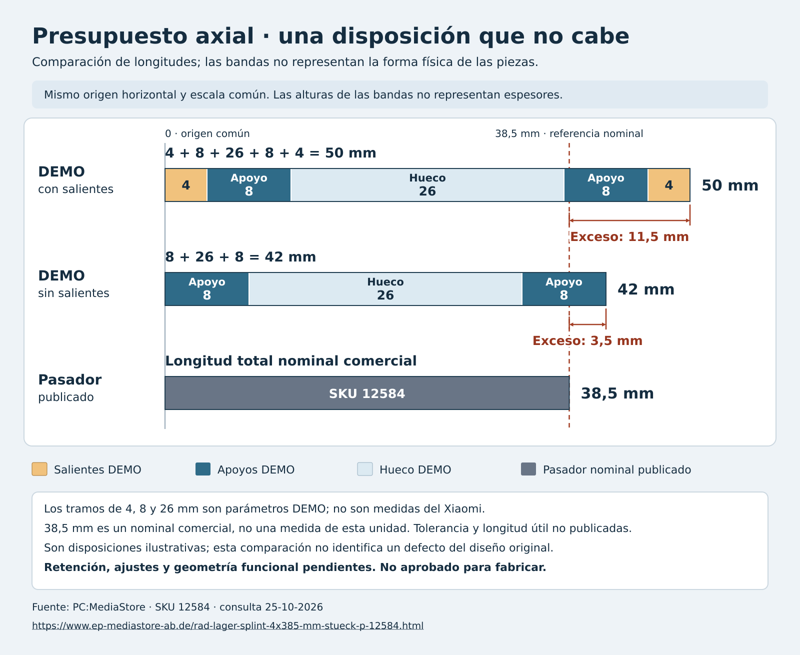

# Estudio del espacio axial del pasador

25-10-2026 · documento FreeCAD separado del maestro de arquitectura · **no fabricable**.

Abrir [X20Pro_Estudio_Axial_Publicado.FCStd](X20Pro_Estudio_Axial_Publicado.FCStd). La hoja `Presupuesto` contiene valores de procedencia explícita y fórmulas editables. El documento tiene dos cilindros simplificados y cinco bandas de diagrama; las bandas no son soportes diseñados.

## Restricción encontrada

El proveedor anuncia el pasador SKU12584 para X20 Pro con **Ø4 × 38,5 mm** [S1]. El estudio DEMO anterior usa 26 mm de hueco, dos apoyos de 8 mm y dos salientes de 4 mm: **50 mm**. Excede el nominal en **11,5 mm**. Incluso al quitar ambos salientes, los **42 mm** resultantes exceden el nominal en **3,5 mm**.

La suma proviene de la revisión de Codex, aportación `f4d87c5626eefc67dadca1b4dc682d857b7a0d21`, sobre el maestro d764569. ChatGPT contrastó la fuente del vendedor y la convirtió a este documento paramétrico. El cálculo se desarrolla en [12, sección 6.1.1](../../12-interfaces-mecanicas-y-estacion.md).

Esto descarta **esa distribución ilustrativa** si se quiere usar ese nominal. No implica que falle la pieza Xiaomi ni que exista un defecto en la demostración. Tampoco autoriza adelgazar apoyos o reducir el hueco necesario de la rueda hasta que los números encajen.

La condición necesaria, para un pasador que atraviesa ambos apoyos, es:

`hueco libre + apoyo A atravesado + apoyo B atravesado + salientes reservados ≤ longitud disponible`

Dentro del hueco se cuenta el cuerpo móvil, su juego y cualquier arandela o pestaña que realmente lo ocupe. No se cuentan elementos dos veces. La longitud útil, tolerancias, retención, dimensiones del módulo y cargas siguen pendientes. Una retención exterior también ocupa espacio de mantenimiento aunque no consuma longitud del pasador.

## Cómo interpretar y editar el archivo

- Las celdas `B2` y `B3` son nominales publicados, sin tolerancias conocidas. No son medidas de la unidad.
- `B4` a `B7` proceden del DEMO v0.1, sin pretensión de ser geometría Xiaomi.
- `B8` a `B11` calculan longitudes y diferencias. Un exceso positivo descarta la distribución indicada.
- Modificar una celda explora una hipótesis. No actualiza la fuente ni convierte la hipótesis en dato publicado o medido.
- La separación vertical entre filas y la sección transversal de las bandas son presentación. No hay transformación al sistema de coordenadas del robot.

Para reproducir el estudio, abrir [crear_estudio_axial.py](crear_estudio_axial.py) como código de macro en FreeCAD o importar el módulo desde su consola Python y llamar a `create_document()`. La función `save_new(doc, ruta)` exige una ruta `.FCStd` que aún no exista. La fuente preferida para continuar editando el estudio entregado es el FCStd.

## Comprobado y pendiente

En FreeCAD 1.1.4 se generaron siete sólidos válidos, se guardó y reabrió el documento, y se cambió temporalmente el hueco DEMO de 26 a 30 mm: el pasador DEMO pasó de 50 a 54 mm y el segundo apoyo se desplazó 4 mm. Se restauraron los valores iniciales antes de guardar. [Registro de software](validacion_software.json).

El maestro anterior y `mediciones.csv` conservaron sus hashes. El primer intento del arnés se interrumpió al consultar el nombre de un documento ya cerrado; se corrigió el orden de esa consulta y el segundo intento completó las comprobaciones. No fue un fallo de geometría ni una prueba de una pieza física.

La revisión de [interfaces y servicio](../REVISION.md) propone sacar el cartucho completo con la suspensión contenida y retirar el pasador en banco si el espacio interior no permite hacerlo. Esa ruta aún debe resolverse geométricamente; no se declara validada.

## Fuente

[S1] [PC:MediaStore, Rad-Lager-Splint 4×38.5 mm, SKU12584](https://www.ep-mediastore-ab.de/rad-lager-splint-4x385-mm-stueck-p-12584.html), consultado 25-10-2026. Fuente primaria de la oferta y de sus dimensiones declaradas; no plano OEM ni tolerancia certificada. Las imágenes del vendedor pueden diferir del producto.

Código MIT; CAD, figura y documentación propios CERN-OHL-P-2.0, según [LICENCIAS](../LICENCIAS.md).
