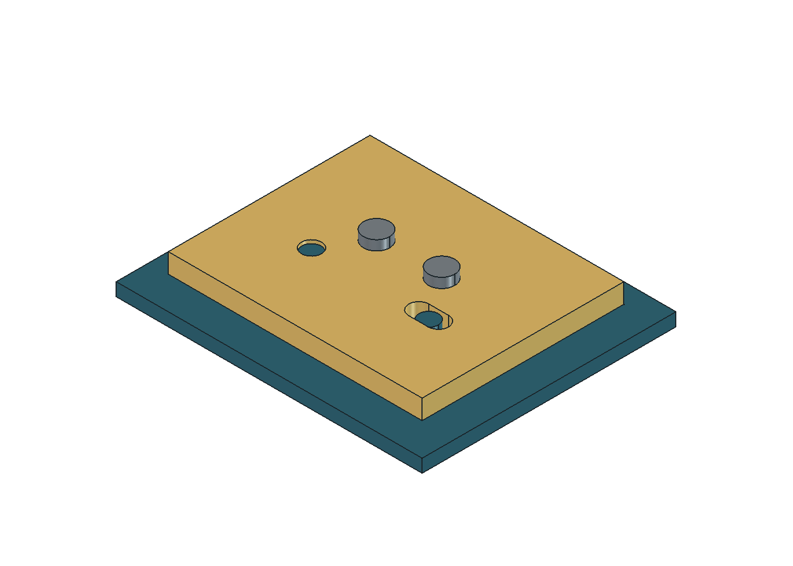
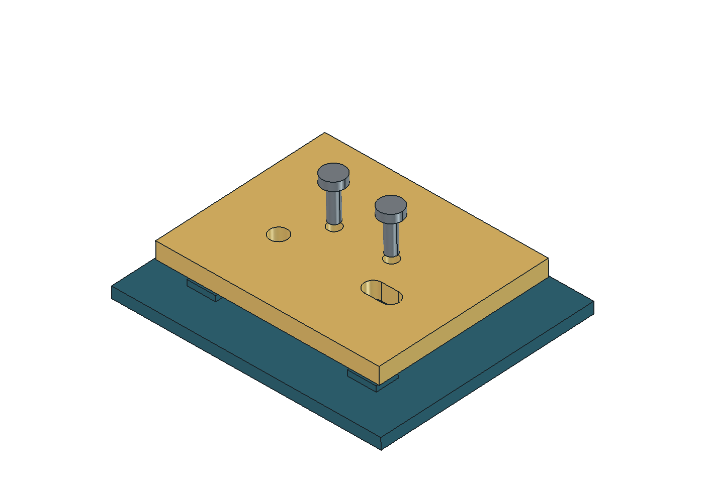

# Estudios de interfaces: pasador y asiento

25-10-2026 · documento FreeCAD separado del maestro de arquitectura · **no fabricable**.

Abrir [X20Pro_Estudio_Axial_Publicado.FCStd](X20Pro_Estudio_Axial_Publicado.FCStd). La hoja `Presupuesto` contiene valores de procedencia explícita y fórmulas editables. El documento tiene dos cilindros simplificados y cinco bandas de diagrama; las bandas no son soportes diseñados.

## Restricción encontrada

El proveedor anuncia el pasador SKU12584 para X20 Pro con **Ø4 × 38,5 mm** [S1]. El estudio DEMO anterior usa 26 mm de hueco, dos apoyos de 8 mm y dos salientes de 4 mm: **50 mm**. Excede el nominal en **11,5 mm**. Incluso al quitar ambos salientes, los **42 mm** resultantes exceden el nominal en **3,5 mm**.

La suma proviene de la revisión de Codex, aportación `f4d87c5626eefc67dadca1b4dc682d857b7a0d21`, sobre el maestro d764569. ChatGPT contrastó la fuente del vendedor y la convirtió a este documento paramétrico. El cálculo se desarrolla en [12, sección 6.1.1](../../12-interfaces-mecanicas-y-estacion.md).

Esto descarta **esa distribución ilustrativa** si se quiere usar ese nominal. No implica que falle la pieza Xiaomi ni que exista un defecto en la demostración. Tampoco autoriza adelgazar apoyos o reducir el hueco necesario de la rueda hasta que los números encajen.

La condición necesaria, para un pasador que atraviesa ambos apoyos, es:

`hueco libre + apoyo A atravesado + apoyo B atravesado + salientes reservados ≤ longitud disponible`

Dentro del hueco se cuenta el cuerpo móvil, su juego y cualquier arandela o pestaña que realmente lo ocupe. No se cuentan elementos dos veces. La longitud útil, tolerancias, retención, dimensiones del módulo y cargas siguen pendientes. Una retención exterior también ocupa espacio de mantenimiento aunque no consuma longitud del pasador.

## Cómo interpretar y editar el archivo

- `Alcance.DiametroFuente` y `Alcance.LongitudFuente` conservan 4 y 38,5 mm de la fuente, como propiedades de solo lectura en el editor. No son medidas de la unidad ni especifican tolerancias.
- `B2` y `B3` son **escenarios**, inicialmente enlazados por fórmula a esos nominales. Sustituir su fórmula permite comparar otro diámetro o longitud sin modificar los nominales conservados. El cilindro y el exceso siguen el escenario; sus etiquetas no contienen cotas fijas. Para volver a la fuente, restaurar `=Alcance.DiametroFuente` y `=Alcance.LongitudFuente`.
- `B4` a `B7` proceden del DEMO v0.1, sin pretensión de ser geometría Xiaomi.
- `B8` a `B11` calculan longitudes y diferencias. Un exceso positivo descarta la distribución indicada.
- Modificar una celda explora una hipótesis. No actualiza la fuente ni convierte la hipótesis en dato publicado o medido. La figura SVG muestra el escenario inicial y no se recalcula al editar FreeCAD.
- La separación vertical entre filas y la sección transversal de las bandas son presentación. No hay transformación al sistema de coordenadas del robot.

Para reproducir el estudio, abrir [crear_estudio_axial.py](crear_estudio_axial.py) como código de macro en FreeCAD o importar el módulo desde su consola Python y llamar a `create_document()`. La función `save_new(doc, ruta)` exige una ruta `.FCStd` que aún no exista. La fuente preferida para continuar editando el estudio entregado es el FCStd.

## Comprobado y pendiente

La revisión 0.3 separa nominales conservados de escenarios editables y elimina las cotas fijas de las etiquetas. El comprobador agrega todas las comprobaciones, incluidos los hashes y posibles errores al cerrar sus documentos, antes de declarar éxito. En FreeCAD 1.1.4, las 24 comprobaciones de la macro y seis comprobaciones adicionales del archivo entregado fueron correctas: editar el escenario a Ø4,4 × 41 mm conserva la fuente Ø4 × 38,5 mm al guardar y reabrir. Se restauraron las fórmulas iniciales. Un control negativo, realizado únicamente sobre una copia descartable, alteró su maestro y obtuvo correctamente resultado global falso. La validación inicial permanece en el histórico del registro; ninguna cambia las limitaciones físicas.

En la validación inicial de FreeCAD 1.1.4 se generaron siete sólidos válidos, se guardó y reabrió el documento, y se cambió temporalmente el hueco DEMO de 26 a 30 mm: el pasador DEMO pasó de 50 a 54 mm y el segundo apoyo se desplazó 4 mm. Se restauraron los valores iniciales antes de guardar. [Registro de software](validacion_software.json).

El maestro anterior y `mediciones.csv` conservaron sus hashes. El primer intento del arnés se interrumpió al consultar el nombre de un documento ya cerrado; se corrigió el orden de esa consulta y el segundo intento completó las comprobaciones. No fue un fallo de geometría ni una prueba de una pieza física.

La revisión de [interfaces y servicio](../REVISION.md) propone sacar el cartucho completo con la suspensión contenida y retirar el pasador en banco si el espacio interior no permite hacerlo. Esa ruta aún debe resolverse geométricamente; no se declara validada.

## Fuente

[S1] [PC:MediaStore, Rad-Lager-Splint 4×38.5 mm, SKU12584](https://www.ep-mediastore-ab.de/rad-lager-splint-4x385-mm-stueck-p-12584.html), consultado 25-10-2026. Fuente primaria de la oferta y de sus dimensiones declaradas; no plano OEM ni tolerancia certificada. Las imágenes del vendedor pueden diferir del producto.

Código MIT; CAD, figura y documentación propios CERN-OHL-P-2.0, según [LICENCIAS](../LICENCIAS.md).

## Asiento desmontable A: geometría de estudio

[X20Pro_Asiento_Desmontable_DEMO.FCStd](X20Pro_Asiento_Desmontable_DEMO.FCStd) es un documento nativo independiente, con primitivas, operaciones booleanas y una hoja de parámetros. **Todas sus cotas son DEMO propias; no reproduce la rueda ni acredita encaje, resistencia o fabricación.** La fuente editable es el FCStd, sin instalar herramientas adicionales.

La placa se apoya en tres zonas. Un alojamiento redondo R limita su desplazamiento en el plano; el segundo pin entra en una ranura D orientada paralela a la línea R–D, que permite variar esa separación. Los dos tornillos tienen pasos con holgura y aprietan la placa; no se usan como centradores. Los juegos siguen permitiendo movimiento residual: no hay repetibilidad física demostrada.

Las coordenadas locales son `u=X`, `v=Y`, `n=Z`. El origen está en el centro del plano de asiento. No se ha fijado su orientación ni posición en el robot.

| Elemento | Cotas del escenario inicial, mm DEMO |
|---|---|
| Placa | 78 × 62 × 6; n de 0 a 6 |
| Base | 94 × 78 × 4; n de −6 a −2 |
| Tres apoyos | 10 × 8 × 2; centros (−28,−22), (28,−22), (0,22); coronación n=0 |
| Resaltes R / D | Ø6; centros (−18,−8) y (18,−8); puntas n=5 |
| Alojamiento R | Ø6,2 pasante |
| Ranura D | 12,2 en u × 6,2 en v; arcos centrados en u=15 y u=21 |
| Fijaciones | Envolventes Ø4, pasos Ø4,6; centros (−10,4) y (10,4) |

Los resaltes están unidos geométricamente a la base. No son pines sueltos apoyados sin retención. La raíz, el material y su eventual sustitución por elementos reemplazables están pendientes. Las fijaciones son envolventes sin rosca: **falta definir la unión hembra, su retención y el acceso de herramienta**. Los puntos de apriete quedan dentro del triángulo de apoyos; eso no prueba rigidez ni estabilidad con cargas y momentos del robot.

### Recorrido y edición

Primero retirar las fijaciones, después elevar la placa en +n. En `Parametros`, `RetiroTornillos=20 mm` representa fijaciones apartadas, y `Elevacion=6 mm` deja el plano inferior de la placa 1 mm sobre las puntas. Esa pose de tornillos es ilustrativa; no verifica su recorrido de desenroscado ni acceso. El archivo se entrega con ambos parámetros a cero.

`BarridoPlaca`, oculto inicialmente, es la caja conservadora u[−39,39], v[−31,31], n[0,12]. Se refiere únicamente a esta placa. No incluye rueda, elemento elástico, cable, herramienta ni extracción de tornillos. El recorrido del futuro cartucho completo sigue pendiente.

La comprobación geométrica usa la cara inferior perforada, extruida a espesor más elevación —n=12 en este escenario—, para representar el barrido continuo. Primero se verifica que reconstruir la placa desde ese perfil reproduce el sólido. No se usa la caja maciza para evaluar interferencia con sus propios localizadores. También se comprueba que desplazar D en u sigue dentro de la ranura y que desplazarlo transversalmente encuentra material.

En FreeCAD 1.1.4 pasaron 16 comprobaciones geométricas y de guardado/reapertura, incluidos cuatro sólidos válidos, tres superficies de apoyo de 80 mm², ausencia de interpenetración en montaje, barrido continuo libre una vez apartadas las fijaciones y bloqueo de salida por cada fijación instalada. [Registro de comprobación del asiento](validacion_asiento.json). El maestro y las mediciones de la base d8a6b0b se preservaron. Es evidencia del escenario geométrico descrito, sin ensayo físico ni aprobación de una unión real.

La suspensión reproducible se diseñará sobre el portador como conjunto independiente. Este asiento no ocupa longitud del pasador de rueda ni obliga a conservar el muelle comercial. El desmontaje del cartucho deberá mantener cerradas la mordaza del elemento elástico y la retención del pivote; el CAD actual todavía no contiene esas piezas.

### Siguiente comparación: accionamiento sin herramientas

El propietario solicita mantenimiento manual con la misma funcionalidad. Las dos fijaciones cilíndricas del FCStd son una referencia geométrica, no una selección final. Se compararán pomos cautivos, palancas sobrecentro con seguro y cuartos de vuelta manuales. La [revisión de integración](../../coordinacion/revision_suspension_codex.md) recoge referencias y criterios. El cierre debe apretar contra estos apoyos sin reemplazar la localización R/D ni liberar la suspensión. Toda geometría cautiva nueva obliga a recalcular la extracción; no se heredan automáticamente los 6 mm de esta placa.
