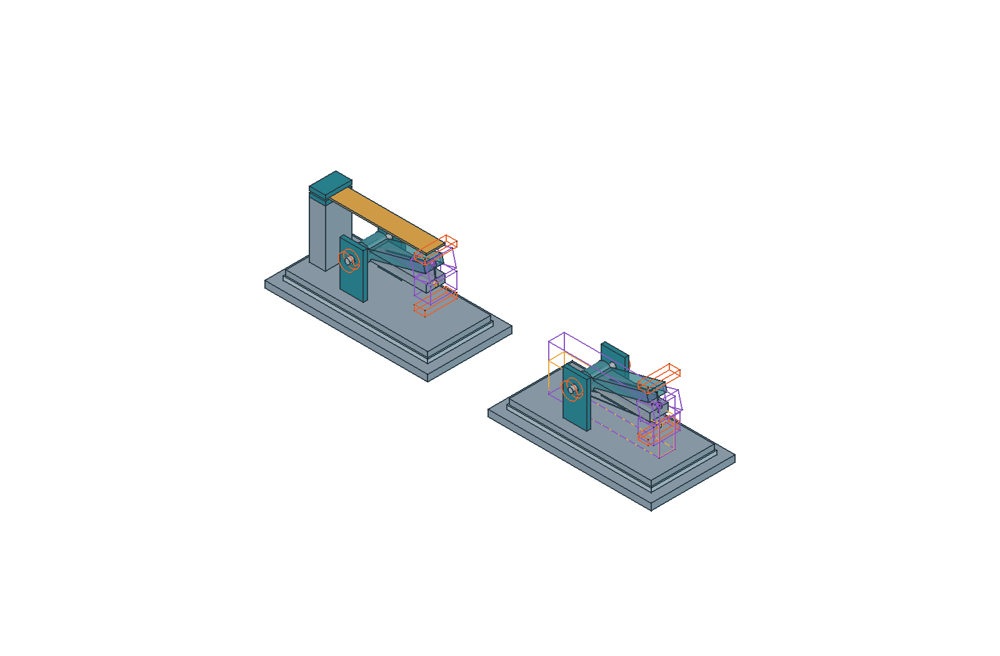
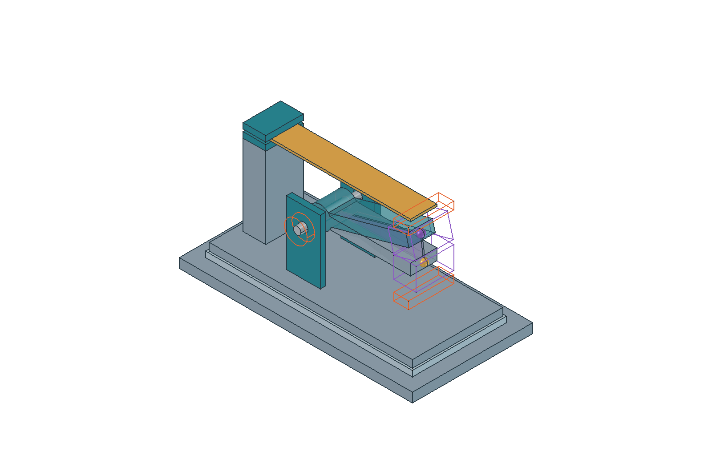
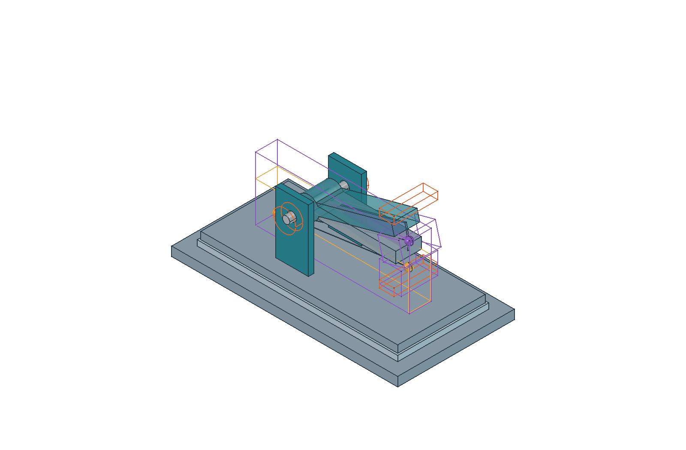
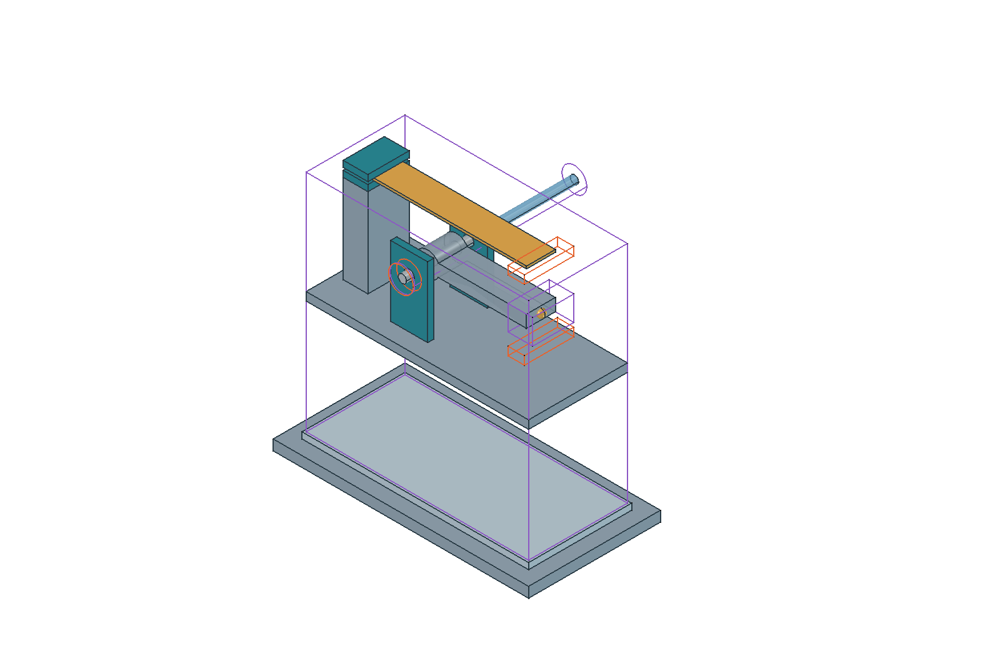

# Estudio comparativo nativo de suspensión

**Revisión inicial 0.3 · 25-10-2026 · HIPÓTESIS VISUALES · NO FABRICAR.**

Abrir [X20Pro_Suspension_Conceptual.FCStd](X20Pro_Suspension_Conceptual.FCStd) en FreeCAD. Es un documento **separado** para comparar cartuchos con lámina y con resorte de alambre a fabricar. El generador [crear_estudio_suspension.py](crear_estudio_suspension.py) reproduce esta revisión inicial sin modificar el maestro de arquitectura ni el estudio axial anterior. Continúa el [capítulo 16](../../16-suspension-reproducible.md).

**El modelo se ha generado, guardado y reabierto en FreeCAD 1.1.4 del equipo del propietario, superando 23 comprobaciones de software. La copia final conserva la geometría comprobada y las cuatro vistas entregadas han pasado revisión visual individual.** El registro es [validacion_software.json](validacion_software.json). Estas comprobaciones verifican geometría nativa, dependencias paramétricas, persistencia y representación de esta entrega; no aprueban fabricación ni funcionamiento físico.

## Qué representa

| Objeto o grupo nativo | Contenido y significado |
|---|---|
| `Alcance` | Límites, licencia, coordenadas locales y funciones pendientes. `FabricacionAprobada=False`. |
| `DatosPublicados` | Sólo nominal comercial del pasador: Ø4 × 38,5 mm, con URL y fecha. No longitud útil ni tolerancia. |
| `HipotesisVisuales` | Dimensiones, ángulo de muestra y separaciones gráficas editables. Cada valor tiene estado y origen inicial. |
| `Procedencia` | Relación entre funciones, hipótesis y referencias pendientes M41–M44/IF01–IF04/IF13. |
| `PresupuestoAxial` | Sumas con apoyo modelado, inicialmente 3 mm, y alternativo, inicialmente 4 mm. El hueco de 26 mm y la reserva de 4 mm conservan procedencia DEMO. |
| `VarianteLamina` | Núcleo, asiento, placa, apoyos, pasador, brazo en dos estados, reservas de retención/topes, mordaza y lámina plana. |
| `VarianteAlambre` | Mismo marco de asiento, pivote y apoyos; reserva longitudinal entre anclajes conceptuales en ambos estados. No hay hélice fabricable. |
| `EscenaExtraccion` | Otra escena con cartucho trasladado +Z local, corredor gráfico y pasador desplazado +Y en banco. Oculta por defecto. |

Los colores distinguen funciones: gris núcleo/placa/brazo, turquesa apoyos/mordazas, dorado elemento o referencia elástica, violeta reservas y movimiento, naranja funciones de retención/topes. No indican materiales elegidos ni resultados de análisis.

El marco es **local y abstracto**: X longitudinal del estudio, Y eje del pasador, Z perpendicular al asiento. La disposición de variantes en pantalla no establece coordenadas del robot. No se ha reconstruido la geometría Xiaomi ni el módulo móvil dañado.

## Vistas del documento ejecutado

Las cuatro imágenes proceden de las escenas del estudio nativo y han sido inspeccionadas individualmente para comprobar que se muestran completas. Se seleccionaron dos capturas de cada una de dos exportaciones de **la misma geometría**, sin modificar el CAD para corregir las imágenes:

| Vista entregada | Procedencia |
|---|---|
| `suspension_comparativa.png` | Última exportación, después de propagar visibilidad y encuadre en la GUI. |
| `suspension_lamina.png` | Última exportación, después de propagar visibilidad y encuadre en la GUI. |
| `suspension_alambre.png` | Exportación anterior, cuya captura completa se comprobó visualmente. |
| `extraccion_conceptual.png` | Exportación anterior, cuya captura completa se comprobó visualmente. |

**Limitación del render:** en este entorno se observó recorte gráfico intermitente al exportar PNG. Algunas capturas omitían partes o cortaban caras pese a conservarse las formas válidas del documento. Las cuatro imágenes incluidas están completas; futuras exportaciones requieren revisar cada PNG, aunque la llamada a `saveImage` termine sin error. Este fallo de representación no constituye un defecto de las formas comprobadas ni una validación física del diseño.

### Comparación de variantes



Mismo asiento y pivote para las dos arquitecturas. Las dimensiones y los estados mostrados son hipótesis visuales; no representan un montaje en el Xiaomi.

### Lámina plana de referencia



La lámina permanece plana mientras el brazo muestra dos posiciones. El contacto, la precarga y la deformación siguen sin resolver.

### Reserva de alambre



Segmentos y cajas entre anclajes conceptuales. El marcador móvil queda bajo el brazo; no se representan una hélice fabricable, un gancho resistente ni fuerzas calculadas.

### Extracción conceptual



Traslación ilustrativa del cartucho y del pasador en banco. Las reservas de acceso no demuestran ausencia de obstáculos ni contención de energía.

## Movimiento editable sin fingir elasticidad resuelta

Cada brazo está dentro de un `App::Part`. El segundo estado utiliza `HipotesisVisuales.AnguloMuestra`, inicialmente **15°**, alrededor del mismo eje que la referencia a **0°**. El brazo, el marcador móvil y la reserva de contacto son solidarios al mismo contenedor. Las dimensiones de ambos brazos dependen de las mismas expresiones.

La rotación positiva alrededor de −Y local eleva el extremo situado en +X. Se usa directamente una cantidad angular en `Placement.Rotation.Angle`. Una comprobación previa de integración en FreeCAD 1.1.4 confirmó que `15 deg` se convierte en `0,261799... rad`; no debe dividirse otra vez por `1 rad`.

El sector semitransparente sólo muestra el barrido del **segmento longitudinal central del brazo** dentro del intervalo ilustrado. Excluye el offset del anclaje móvil de alambre: no es el segmento que une el pivote con ese marcador desplazado. **No es la envolvente de colisión del cuerpo del brazo**, del ojo, contacto, rueda, cable, detector o herramienta. Sus espesores y volúmenes adicionales no están cubiertos por ese sector.

La lámina permanece **plana**, tanto con el brazo de referencia como con el de muestra. Puede existir separación o interferencia con una reserva: el modelo no obliga a satisfacer contacto, no calcula deformación y no simula una precarga.

En alambre, los segmentos y cajas cambian al mover el anclaje conceptual móvil. Los valores iniciales sitúan el fijo debajo y antes del pivote, de modo que la distancia entre anclajes aumenta al pasar de 0° a 15°. Esto es una comprobación geométrica del sentido propuesto, **no una fuerza calculada, tensión inicial ni garantía de contacto/tracción**. Cambiar posiciones o ángulo exige volver a comprobar el signo. La caja no representa un diámetro real de resorte.

El marcador móvil de alambre queda inicialmente 8 mm por debajo del eje local del brazo, mediante `AlambreMovilBajo`, también **hipótesis visual**. Así el segmento no atraviesa el extremo del sólido del brazo en los estados iniciales. El marcador y su reserva giran con el brazo; las fórmulas de la línea incluyen el mismo offset rotado. No se ha dibujado una orejeta que afirme resolver la transmisión de carga: esa interfaz permanece pendiente. Una caja de reserva puede solaparse con piezas; no equivale a un sólido de resorte ni a una comprobación de colisiones completa.

El ángulo de muestra no es un límite admisible. Valores que degeneren primitivas, por ejemplo un sector de ángulo 0°, pueden producir avisos geométricos; para ver el estado 0° ya existe el grupo de referencia. Modificar una hipótesis no debe describirse como obtener una medida real.

## Presupuesto axial sin convertir una suma en compatibilidad

Los valores iniciales son:

| Escenario ilustrativo | Suma | Comparación con 38,5 mm nominales |
|---|---|---|
| Apoyos de 3 mm y reserva de 4 mm por extremo | 26 + 2 × 3 + 2 × 4 = **40 mm** | Margen aritmético **−1,5 mm**. |
| Apoyos de 4 mm y la misma reserva | 26 + 2 × 4 + 2 × 4 = **42 mm** | Margen aritmético **−3,5 mm**. |

El pasador dibujado mantiene su longitud nominal; no se alarga para cubrir reservas. Las zonas naranjas **no son retenes diseñados**. Estas sumas iniciales no caben en el nominal total y se conservan para mostrar la restricción. No se reduce un ancho desconocido ni se elige una reserva arbitraria menor para declarar encaje. Un margen positivo, si se exploran otros valores, tampoco demuestra ajuste, longitud útil, retención o resistencia.

El ancho de 14 mm inicial del brazo es una hipótesis independiente de presentación. No representa el ancho móvil M41/M42, ni se obtiene restando una supuesta holgura al hueco DEMO. El taladro de 5 mm inicial es igualmente visual: no es una tolerancia seleccionada para el nominal Ø4 mm.

## Servicio y energía

Activar `EscenaExtraccion` y ocultar las otras escenas permite estudiar la separación del cartucho respecto al núcleo. Las traslaciones iniciales de 55 mm y 45 mm son **hipótesis gráficas**. El corredor no comprueba obstáculos en el robot. El segundo cilindro de pasador es otro estado de la misma referencia, no una pieza adicional de la BOM.

**Objetivo pendiente:** extraer el cartucho manteniendo control de la energía y descargarlo mediante un procedimiento diseñado. No hay cierre, pestillo o mecanismo de contención resuelto. Separar físicamente objetos en CAD no demuestra que se puedan retirar de forma controlada. La retirada del pasador corresponde a una operación posterior en banco; no se presenta como extracción directa con un resorte cargado.

El asiento representa la interfaz común; **posicionamiento y apriete siguen siendo funciones por diseñar**. Topes, guiado, retención, detector y cableado se mantienen separados de la función elástica. No se supone que una mordaza o un gancho resuelvan también la guía del pivote o la rotura móvil original.

## Ejecutar desde FreeCAD

**Preferencia posterior comunicada por Codex:** las nuevas aperturas, generaciones y comprobaciones automatizadas en el PC se harán sin interfaz gráfica. La receta de render gráfico de esta sección documenta cómo se produjo la entrega anterior a esa indicación; no autoriza iniciar nuevas sesiones gráficas. `create_document()` y `build(..., render=False)` separan la generación del render. Las capturas publicadas ya están generadas e inspeccionadas.

Usar la consola Python o el ejecutor de integración, con una ruta real a este script:

```python
import importlib.util
from pathlib import Path

script = Path("/ruta/al/proyecto/cad/suspension/crear_estudio_suspension.py")
spec = importlib.util.spec_from_file_location("x20_estudio_suspension", str(script))
study = importlib.util.module_from_spec(spec)
spec.loader.exec_module(study)

doc = study.create_document()
study.save_new(doc, Path("/ruta/salida/nueva/X20Pro_Suspension_Conceptual.FCStd"))
# Sólo en sesión gráfica, después de comprobar que la vista funciona:
study.export_views(doc, Path("/ruta/salida/nueva/vistas"))
```

La API abreviada `study.build(output_dir, render=False)` crea y guarda el documento; devuelve el documento abierto. `save_new` y `build` rechazan sobrescribir un FCStd existente. `export_views` produce cuatro PNG y rechaza sobrescribirlos salvo `overwrite=True`. No hay exportación STL ni STEP de fabricación.

Las anotaciones internas quedan ocultas por defecto y en las cuatro vistas exportadas para no tapar piezas. Los avisos se consultan en el título del documento y en `Alcance`/el árbol; al integrar imágenes deben acompañarlas sus pies explicativos. Después de ajustar la vista se añade un 15 % de margen mediante la altura de la cámara ortográfica. Este ajuste sólo modifica la presentación, no geometría, posiciones de piezas o parámetros.

El documento utiliza primitivas, booleanas, contenedores y expresiones **nativas**; no depende de un `Proxy` Python geométrico, Assembly 4 ni otro complemento. El script sólo reproduce esta revisión inicial. Para continuar un estudio editado, abrir su FCStd y conservarlo como fuente maestra de esa revisión.

## Comprobación de software ejecutada

La ejecución nativa en **FreeCAD 1.1.4 del equipo del propietario** superó **23 comprobaciones**, registradas en [validacion_software.json](validacion_software.json). Entre los resultados están:

| Comprobación | Resultado registrado |
|---|---|
| Construcción y geometría nativa | **223 objetos**, de los que **199 tienen `Shape` válidas**. El recuento incluye auxiliares y grupos: **no son 199 piezas físicas**. |
| Cambio de ángulo | **15° → 20° → 15°**, con propagación y restauración de dependencias. |
| Cambio de espesor de apoyo | **3 mm → 4 mm → 3 mm**, con actualización y restauración del estudio. |
| Cambio de extracción | **55 mm → 65 mm → 55 mm**, con actualización y restauración del estado de servicio. |
| Persistencia | Documento guardado, cerrado, reabierto y recalculado. |
| Fabricación | **Sin aprobación**; se mantienen las hipótesis y los requisitos físicos pendientes. |

El SHA-256 del generador sometido a esa ejecución, **anterior al ajuste exclusivamente visual de anotaciones y encuadre**, es:

`278dabc1b79f593626345f5c73b25b07abab1dd4a09a6065ffebec94ee8caffa`

La copia final se ha guardado y reabierto en FreeCAD sin errores. Conserva los 223 objetos y sus valores. En el cotejo de los 516 miembros originales del FCStd, la única diferencia se limita a `GuiDocument.xml`: dos visibilidades y la cámara. Los **121 archivos BREP/mapa permanecen idénticos**. El SHA-256 del FCStd final es:

`a6558e9570e649203275e4bb97c1b21a2759aac40f5bb8eff0e82c2b9f27097e`

Las cuatro capturas de esta entrega han pasado revisión visual con la procedencia individual indicada arriba. No se repitieron las 23 comprobaciones ni se alteró la geometría para resolver la presentación: se comprobó la conservación del modelo y se seleccionaron las capturas completas de las dos exportaciones.

### Cómo reproducir las comprobaciones

Si se modifica el estudio, estos controles permiten repetir la comprobación en FreeCAD 1.1.4:

1. Recalcular sin errores de expresiones; sólidos finales y segmentos no nulos y válidos. Los auxiliares de booleanas deben quedar ocultos.
2. Revisar dos estados de cada brazo y la reserva de alambre, sin que una curva decorativa se interprete como solución elástica.
3. Cambiar `AnguloMuestra`, por ejemplo de 15° a 20° y volver: brazo, marcador y reserva móvil giran juntos; sector y segmento/caja de alambre responden. No interpretar ese cambio como prueba de recorrido admisible.
4. Cambiar `ApoyoEspesor` de 3 a 4 mm y volver: ambas variantes y la escena de servicio actualizan apoyos/reservas; `PresupuestoAxial` responde, y la longitud nominal del pasador permanece en 38,5 mm.
5. Cambiar `ExtraccionCartucho` de 55 a 65 mm y volver: el núcleo/asiento quedan fijos y el cartucho de servicio se traslada con sus piezas. Comprobar que los valores de escena no se convierten en cotas globales del robot.
6. Guardar, cerrar, reabrir y recalcular el FCStd sin necesitar reejecutar el generador. Revisar cada captura desde GUI real: una exportación con OpenGL ausente puede producir una imagen vacía y, en el entorno comprobado, se observó además recorte gráfico intermitente de formas válidas.

Las comprobaciones anteriores sólo verifican representación, dependencias y persistencia. **No validan** contacto, movilidad completa, colisiones, ajustes, tornillería, materiales, carga sostenida, fatiga, detector, estación ni fabricación.

Revisión mecánica independiente: [REVISION_MECANICA.md](REVISION_MECANICA.md). Su alcance y estado se registran allí; las comprobaciones de software no sustituyen la revisión de interfaces ni los ensayos físicos pendientes.

## Licencias

Código de este generador: **MIT**. Geometría conceptual y documentación originales: **CERN-OHL-P-2.0**, con alcance en [../LICENCIAS.md](../LICENCIAS.md). No se ha incorporado geometría de proyectos externos. La fuente comercial del pasador respalda únicamente el nominal publicado, no derechos sobre geometría o firmware del fabricante.
